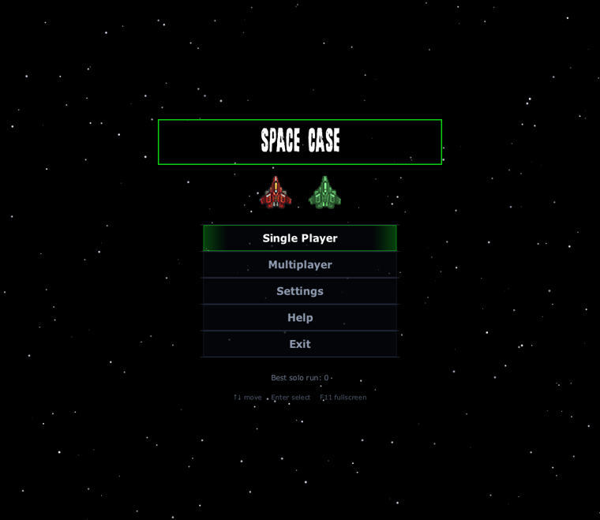
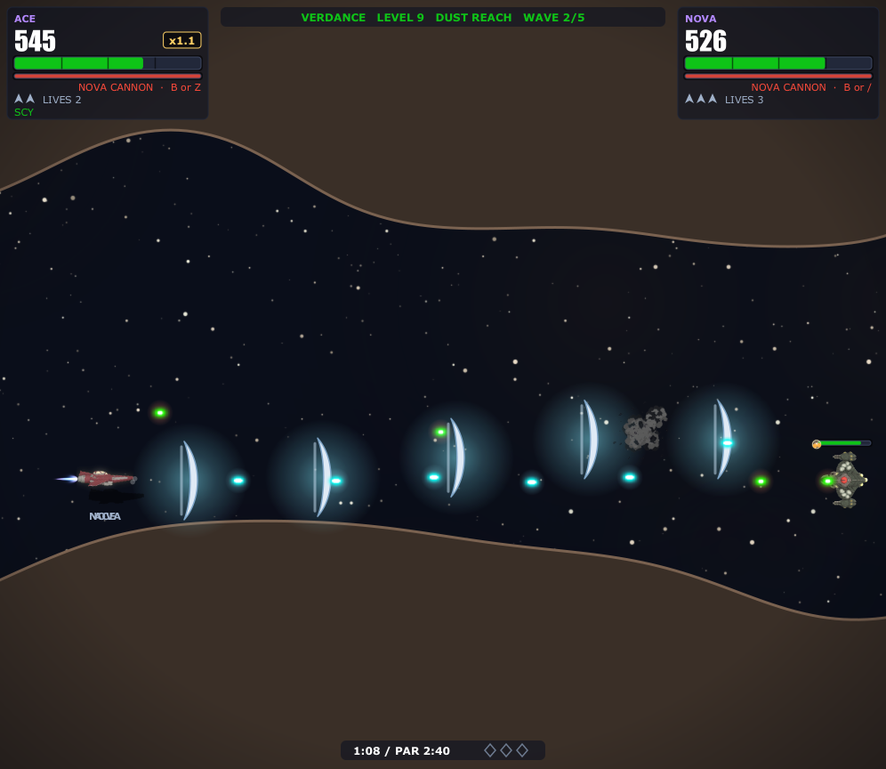
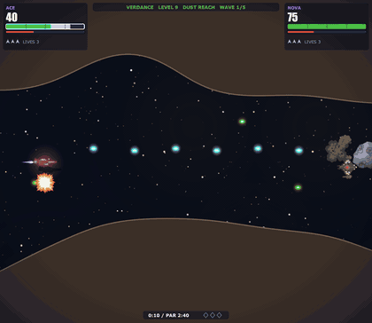
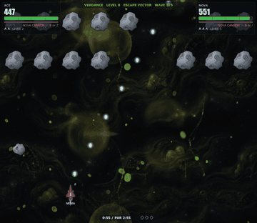
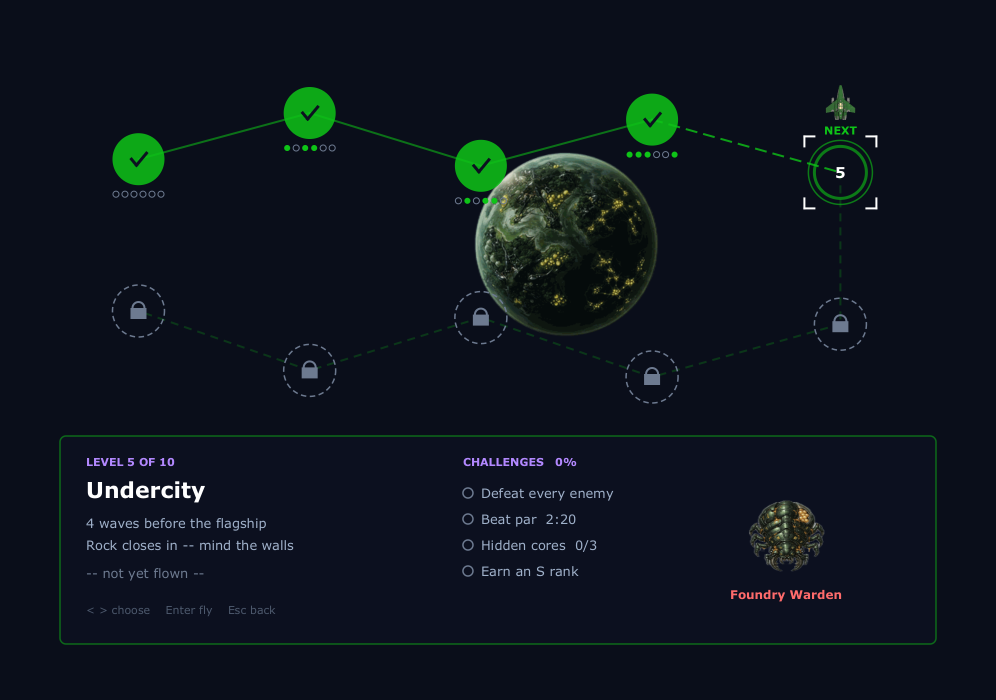
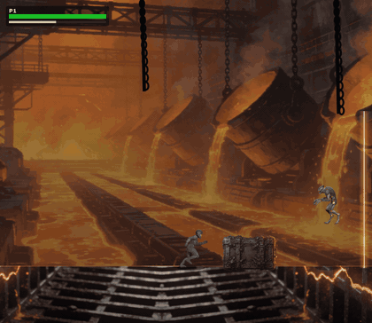
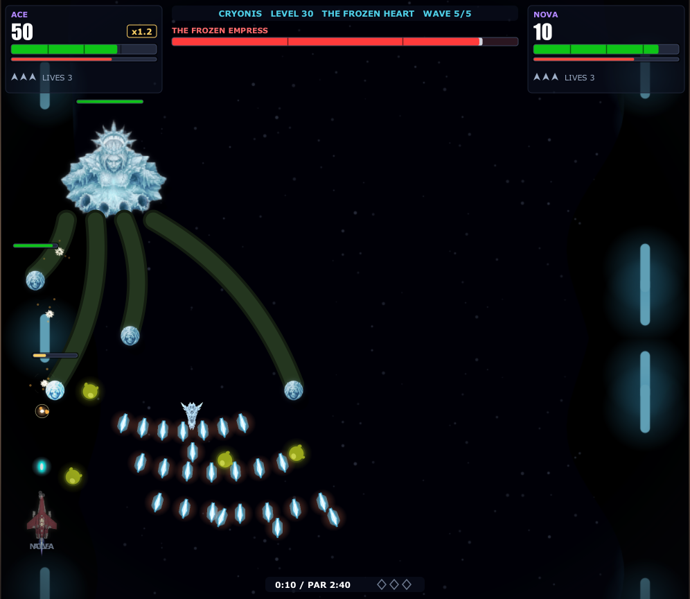
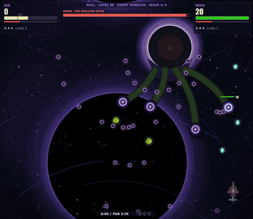
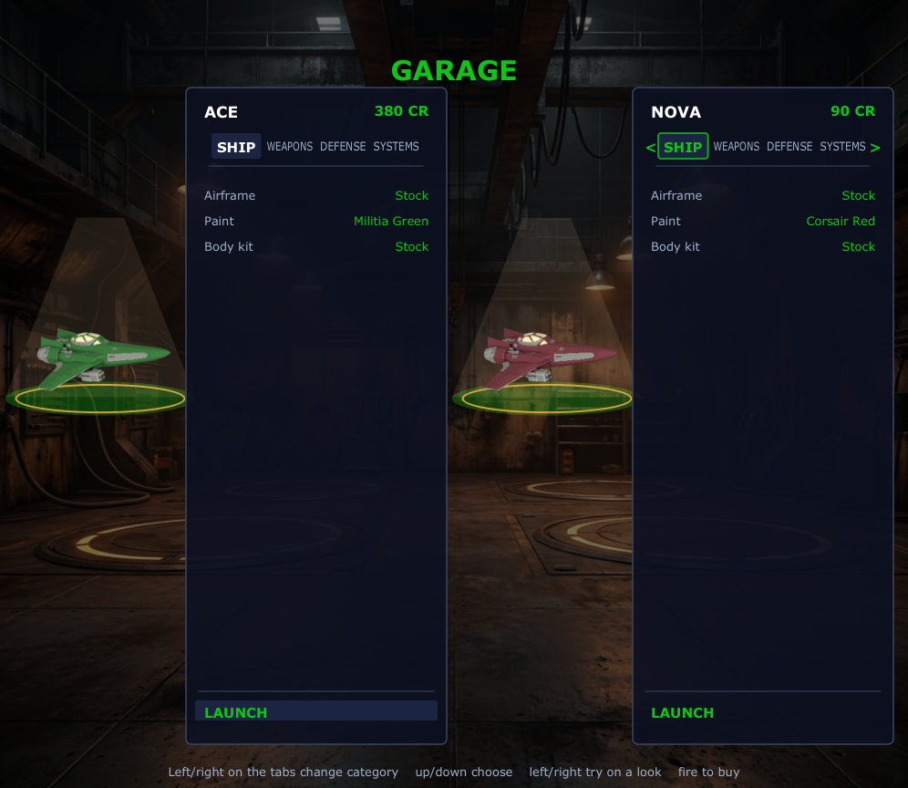

# Space Case

[](https://github.com/hashjaco/Space-Wars/actions/workflows/ci.yml)
[](LICENSE)
[](https://adoptium.net)
[](https://openjfx.io)

A 2D space shooter: fly, dodge asteroids, shoot up enemy ships, fight fifty flagships across five
galaxies — or turn on each other in Battle mode. Two players share one keyboard, or two to four fly
together online.

Originally written as *Space Wars* to get comfortable before building a game engine from scratch.

<p align="center">
  
</p>

<p align="center">
  
  
</p>

## Installing it

Grab the one for your machine from [Releases](https://github.com/hashjaco/Space-Wars/releases) and
open it. Java is bundled — there is nothing else to install.

| | |
|---|---|
| macOS | `SpaceCase-*.dmg` |
| Windows | `SpaceCase-*.msi` |
| Linux | `spacecase_*.deb` |

The builds are unsigned, so the first launch needs a nudge past the gatekeeper: on macOS right-click
the app and choose **Open**; on Windows pick **More info** then **Run anyway**.

Already have a JDK 26? `java -jar space-case-<your-platform>.jar` from the same page skips the
installer.

## Running it from source

    ./mvnw javafx:run

The wrapper fetches the right Maven itself, so a [JDK 26](https://adoptium.net) is the only
prerequisite. On Windows use `mvnw javafx:run`.

If that stops at *Unable to locate a Java Runtime*, the wrapper cannot see your JDK. Check with
`java -version`. Homebrew's `openjdk` is keg-only and stays invisible to the system Java wrappers
until you link it:

    sudo ln -sfn /opt/homebrew/opt/openjdk/libexec/openjdk.jdk \
      /Library/Java/JavaVirtualMachines/openjdk.jdk

`brew install --cask temurin` registers itself and needs no such step. Either way, pointing
`JAVA_HOME` at the JDK also works.

JavaFX stopped shipping inside the JDK in Java 11, so `pom.xml` pulls it from Maven Central
(including the platform natives) and puts it on the module path. `javafx.version` tracks the JDK major
version — JavaFX 26 needs a JDK 26 runtime.

Other targets:

    ./mvnw test               # unit tests; no display, audio device or controller needed
    ./mvnw package            # target/space-case-<version>.jar
    ./mvnw package -Pshaded   # one self-contained jar for this platform

Installers are built by `jpackage`, which ships inside the JDK; the release workflow runs it once per
operating system.

## Modes

| Mode | Players | Enemies | Friendly fire | Ends when |
|---|---|---|---|---|
| Single Player | 1 | yes | no | you run out of lives, or the galaxy's last flagship falls |
| Co-op | 2 | yes | no | both players are out, or the galaxy is cleared |
| Battle | 2 | none | **yes** | one player is left |
| Endless Run | 1 | yes | no | you run out of lives — the fifty levels loop with rising spawn pressure |
| Online co-op | 2–4 | yes | no | as Co-op, over a relay |

In Battle, player two starts at the top of the arena facing down, both players' shots hurt each
other, and asteroids and power-ups keep arriving as shared hazards and prizes. Endless Run appears on
the start menu once the campaign has been cleared.

**Universe Map** shows the five galaxies and the ten places in each; clearing a place unlocks the
next, and the map remembers how far you got. **Continue** picks up the last checkpoint, **Load Game**
holds three save slots, and **Cloud Save** carries a profile to another machine with a twelve-character
code. **Leaderboard** posts a run's score per mode, along with a recording of the run; a scheduled job
replays recordings through the game's own simulation and marks a score with a tick once it has
reproduced it (see [`server/`](server/README.md)).

### Online

**Multiplayer → Host Online** hands you a six-character room code; **Join Online** takes one. Two to
four ships fly the co-op campaign in deterministic lockstep: every machine runs the same simulation
and only the sticks cross the wire, through a small WebSocket relay on Cloudflare Workers (see
[`server/`](server/README.md)). Everyone checks in with a loadout before the host can start.

If a pilot's connection drops, the match holds still for everyone and says so; that pilot's game
rejoins by itself and is fed the input it missed. After thirty seconds the host's machine gives the
seat up and the rest fly on with the missing ship holding neutral.

## Controls

| | Move | Fire |
|---|---|---|
| Player 1 | `W` `A` `S` `D` | `SHIFT` |
| Player 2 | arrow keys | `,` |
| Any controller | left stick or d-pad | `A` / cross |

Single player accepts either WASD or the arrow keys, and fires with `SHIFT` or `SPACE`.
`ESCAPE` pauses, `F11` toggles fullscreen. Menus take the arrows or `W`/`S`, `Enter` to choose.

### Controllers

Pair a Bluetooth pad — DualSense, Xbox Wireless, Switch Pro and 8BitDo among them — or plug one in,
and it works without setup: menus included. The first pad plays as player one and the second as
player two, and the keyboard keeps working alongside them, so two people can share a pad and the
keys. Both pads drive the menu cursor, the same way two people on one keyboard would.

Anywhere the game wants a name or a code -- Pilots, Cloud Save, a room code -- choosing the field
opens an on-screen keyboard you walk with the d-pad. Nothing types letters straight off a keypress
any more: player one's pad speaks the same `W A S D` the ship does, so a field that read letters had
no way to tell a d-pad push from a typed W.

The left stick is analog: the ship flies at the speed you push it, and the hull banks harder the
further you lean. Switch `Stick mode` to `Digital` in Settings for the older all-or-nothing feel.
`Start` pauses.

`P1 stick` and `P2 stick` set how sharply each pad answers, from 50% to 200%. This changes *response,
not top speed* — a full push gives the ship everything it has at every setting, so it cannot outrun
the garage speed upgrades or hand one player the edge in Battle. Wind it down to 50% for fine control
threading a bullet pattern; wind it up to 200% if the ship feels sluggish off centre.

Holding a direction in a menu moves one row, pauses, then walks at about two and a half rows a
second, so you can stop where you meant to. Tapping always moves exactly one. This covers the
keyboard and the garage as well as the pad.

Settings also carries the fire and pause buttons **per player**, the stick deadzone (raise it if a
worn stick drifts on its own), an off switch, and a row naming the pads currently recognised. A pad
going flat mid-game drops back to the keyboard rather than leaving your ship drifting.

**If your controller does nothing**, check that last row. Recognition comes from a bundled copy of
[SDL_GameControllerDB](https://github.com/mdqinc/SDL_GameControllerDB); SDL only opens a pad it has a
mapping for, so one released after that copy was pinned may not be recognised. You do not need to
wait for a release — grab the current database and point SDL at it:

```sh
SDL_GAMECONTROLLERCONFIG_FILE=/path/to/gamecontrollerdb.txt ./mvnw javafx:run
```

## Power-ups

Dropped by defeated enemies, and none of them expire — dying is what clears them. Tri-shot, mega
laser, rockets, speed boost, shield, health refill and extra life come off the common table; the
scythe, flak and nova are rarer, each dropped by one hull class. The HUD lists what you are carrying.

## Levels

Fifty places in five galaxies, ten each: **Verdance**, **Ashfall**, **Cryonis**, **Tempest** and
**Null**. Every place has its own parallax sky, its own three hull families of defenders, and its own
flagship; sixteen of the fifty levels are flown side-on, where hostiles are drawn in true profile. A run through a galaxy ends when its tenth flagship falls,
and the Universe Map opens the next. Only Endless Run keeps going past the end, looping the fifty
with higher spawn pressure each time round.

Halfway through each level's waves a set piece breaks them up: an asteroid field to thread, a swarm,
an ace, or a salvage drift. Every level also carries four challenges (defeat every enemy, beat par,
find its three hidden cores, earn an S rank), which pay credits and never score.

<p align="center">
  
  
</p>

One level in each galaxy does not end in orbit: the pilots land and finish it on foot, brawling
through to that stage's own boss and lifting off with what they came for.

<p align="center">
  
</p>

## Enemies

Scouts, fighters and cruisers arrive in authored waves that get tougher. After a level's last wave its
flagship descends, changing attack pattern as you wear it down — spreads, sweeping fans, aimed bursts,
rings, spirals, spawned escorts, vortices — and firing its galaxy's special every fourth volley:
lance, scatter, crossfire or barrage. The set pieces are a multi-headed hydra, burrowing worms,
piloted mechs you take apart limb by limb, and Aeon at the end of Null.

<p align="center">
  
  
</p>

## Between levels

Killing a flagship does not drop you straight into the next place. The surviving ships accelerate off
the top of the screen, then a debrief reports what the level cost you — kills, accuracy, damage taken,
lives lost, clear time — and pays the bonuses it earned: a flagship bounty, marksman, untouched,
unbroken, and swift for beating the level's reference time. Press any button and the game warps, which
is also when the next level's art is decoded in the background.

Between the debrief and the warp is the **garage**: bonuses become credits, and credits buy fourteen
upgrades across firepower, hull, handling and salvage, plus a chassis, a kit and a paint job that
travel with the pilot.

<p align="center">
  
</p>

## Pilots and rank

Name both seats from **Pilots** on the start menu; choose a seat and an on-screen keyboard opens over
it, so a name can be entered with a controller as easily as with the keys. The name shows under the
ship. Level bonuses are
credited to a career total stored against that name, and the career total sets a rank on a
twenty-six-step ladder from Recruit to Fleet Marshal. Career progress is keyed by name rather than by
seat, so a pilot keeps their rank whichever side of the keyboard they take.

## Layout

```
src/main/java/com/hashimjacobs/spacecase/
  Main.java  Launcher.java  GameConfig.java
  scene/   SceneRouter and every screen (start, multiplayer, settings, help,
           pause overlay, game over) plus the menu widgets and navigator
  mode/    GameMode + ModeRules — what differs between the modes, as data;
           Galaxy and Level — the fifty places; Waves — the authored waves;
           Debrief — what clearing a level pays
  engine/  GameLoop, FixedTimestep, World, CollisionSystem, SpawnDirector,
           EnemyWeapons, Renderer, Hud, Terrain, ShipController, InputState,
           Gamepad, GamepadMapping, PadState, DebriefOverlay, GarageOverlay
  entity/  Entity, PlayerShip, EnemyShip, Boss and BossPhase, the multi-part
           bosses (BossHead, BurrowingWorm, PilotedMech, VoidEntity),
           Asteroid, Bullet, Rocket, PowerUp, WaveShip
  garage/  Chassis, Kit, Livery, Upgrade, Loadout, GarageSession
  net/     Lockstep, RelayClient, Packet, LobbyModel, Cloud — online play
  asset/   Assets + the Sprite / BossArt / SoundFx / MusicTrack / Explosion enums, SoundBank
  prefs/   Settings, HighScores, SaveGames, Pilots, Rank and Standing, via java.util.prefs
  ui/      Tokens — the design tokens every screen draws from
server/    The Cloudflare Worker relay: rooms, leaderboard, cloud save
tools/     GenerateAssets.java — regenerates the art and audio; preview/ draws things to look at
src/test/java/...   JUnit 5
```

Four invariants worth knowing before changing the engine, each of which was a bug once. They are
spelled out in [CONTRIBUTING.md](CONTRIBUTING.md); the short version:

- **`World` is the only place entities are added or removed** — collisions only mark, `sweep()`
  removes.
- **Sprites and sounds are enums, not string keys** — a missing asset is a compile error.
- **Simulation speed must not depend on the display** — the loop steps at a fixed 1/60 s.
- **Assets load from the classpath, not the working directory** — so the jar runs from anywhere.

## Soundtrack

Ten original instrumental tracks. Which one plays is chosen by *cue* rather than fixed per screen —
gameplay rotates between three tracks and battle between two, so replaying a mode does not always
sound the same, and a boss arriving swaps the music until it dies.

| Cue | When |
|---|---|
| `MENU` | Start screen, submenus, game over |
| `GAMEPLAY` | Single player and co-op |
| `BATTLE` | Battle mode |
| `BOSS` | While a flagship is on screen |
| `HYDRA_BOSS`, `LEVIATHAN_BOSS` | The two monsters, each with a cue to itself |
| `GARAGE` | Between the debrief and the warp |

Re-pointing a cue at different tracks is a one-line edit in `asset/MusicCue.java`.

## Assets

Every bundled file's origin is recorded in [ASSETS.md](ASSETS.md), and a test fails the build if that
drifts. The music is composed by the author; the art is either hand-drawn by the author or generated
by `tools/GenerateAssets.java`, which is committed and deterministic — `java tools/GenerateAssets.java`
reproduces it byte for byte, and CI checks that it still does.

The fonts in `fonts/` (Exo 2 for text, one display face per galaxy for level titles) are third-party
under the SIL Open Font License, each with its licence file beside it; see ASSETS.md.

## Licence

[MIT](LICENSE) — code and assets alike, except the bundled fonts, which are SIL Open Font License (see ASSETS.md).

The release jars carry two third-party runtimes: JavaFX ([GPLv2 with the Classpath
Exception](https://openjdk.org/legal/gplv2+ce.html)) and, for controller support,
[Jamepad](https://github.com/libgdx/jamepad) (Apache 2.0) with the copy of
[SDL](https://libsdl.org) (zlib) it wraps.

One third-party data file is bundled rather than linked:
[SDL_GameControllerDB](https://github.com/mdqinc/SDL_GameControllerDB) (zlib), the controller mapping
database. See [ASSETS.md](ASSETS.md) for the pinned revision and why it ships.
